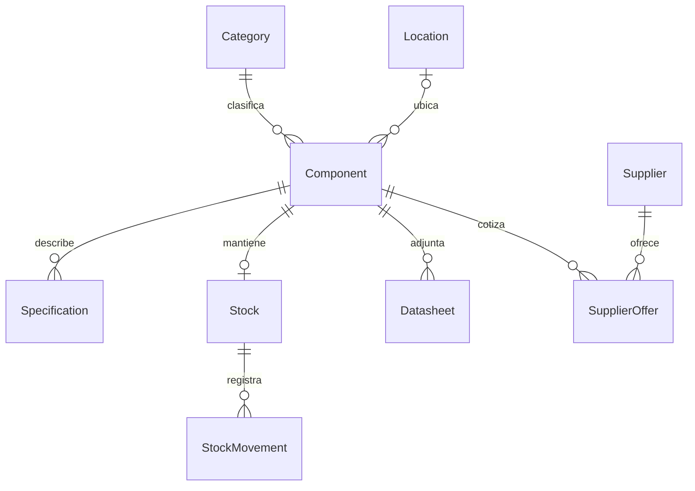
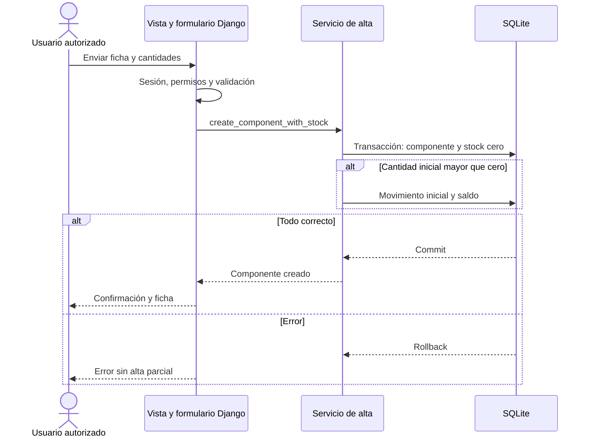
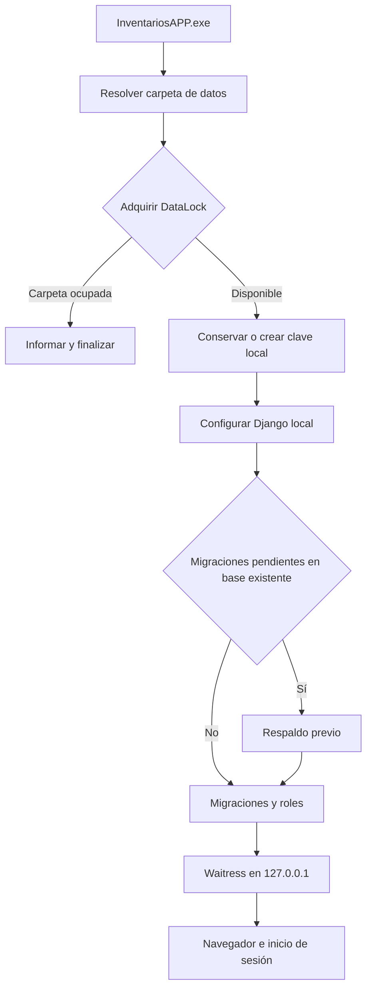

# Modelo de datos y flujos

## Relaciones persistentes

Cada componente tiene categoría obligatoria y ubicación opcional; una ubicación
puede contener muchos componentes. Hay a lo sumo un Stock por componente; el alta
propia siempre lo prepara, aunque datos heredados pueden no tener stock.
Un movimiento pertenece a un Stock. El máximo de stock igual a cero significa sin
máximo configurado. Un Datasheet conserva una ruta de archivo, no bytes PDF en SQLite.

Restricciones: referencia única por categoría, atributo único por componente,
oferta única por componente/proveedor/número de parte, request_id único cuando existe.
Category, Location y Supplier usan PROTECT en las relaciones de referencia;
StockMovement protege su Stock. No borrar referencias en uso ni eliminar historial.

El subsistema estándar django.contrib.auth aporta User/Group/Permission y sus
relaciones. Las sesiones Django también se almacenan en SQLite. No existe una
tabla separada de perfil: se editan username, first_name, last_name y email de User.

Fuentes: apps/components/models.py, apps/inventory/models.py,
apps/documents/models.py, apps/suppliers/models.py y apps/core/views.py.

## Registrar un componente

Fuente: apps/components/services.py:8–25 y apps/components/views.py.

## Movimiento de stock

Vista previa valida y muestra el resultado sin escribir. Al confirmar, el servicio
verifica request_id y saldo original. Un reenvío idéntico devuelve el movimiento
previo; un request_id con otros datos se rechaza. Si el saldo cambió, se pide recargar.
StockMovement.save() aplica el delta y guarda el historial atómicamente. Las salidas
no dejan saldo negativo; las entradas/ajustes respetan máximo cuando está configurado.
La corrección se hace con otro movimiento, conservando el historial.

Fuentes: apps/inventory/views_movement.py, services.py:14–32 y models.py:148–173.

## Arranque del ejecutable

Este flujo describe serve, comando predeterminado. manage, init, backup y restore
son otras ramas de launcher.py; no arrancan el servidor. No se crea automáticamente
un administrador: se usa manage createsuperuser. Al detener, se cierran servidor,
hilos y conexiones antes de liberar el bloqueo.
